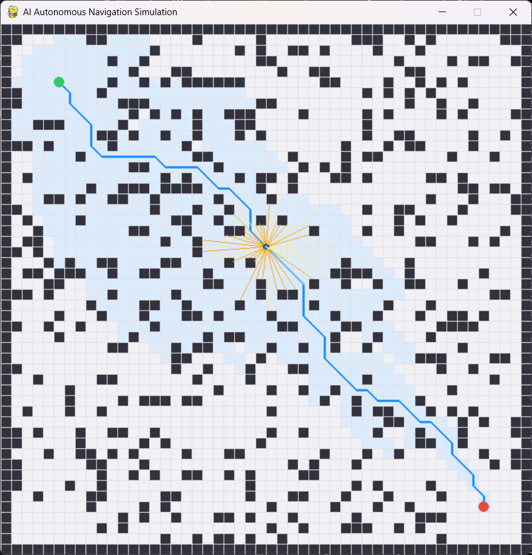

# AI-Based Autonomous Navigation System

A simulation-first autonomous mobile robot navigation framework written in Python. The project implements classical 2D path planning algorithms, clearance-aware costmaps, collision checking, geometric path smoothing, and a real-time pygame visualizer — all tied together with a test-driven architecture and a multi-resolution physical consistency validator.

> **Scope**: This is a software simulation project. It does not interface with physical hardware, ROS, or any real robot. All results are produced by the simulation engine on a 2D occupancy grid.

---

## Table of Contents

1. [Features](#features)
2. [Repository Structure](#repository-structure)
3. [Installation](#installation)
4. [Running the Simulation](#running-the-simulation)
5. [Running Benchmarks & Validation](#running-benchmarks--validation)
6. [Running Tests](#running-tests)
7. [Algorithms](#algorithms)
8. [Reported Results](#reported-results)
9. [Current Limitations](#current-limitations)
10. [Roadmap](#roadmap)
11. [License](#license)

---

## Features

All of the following are implemented and tested in the current source tree.

| Component | Description | Source |
| :--- | :--- | :--- |
| **Occupancy Grid Map** | 2D discrete grid with configurable resolution, boundary checks, and obstacle placement | `environment/grid_map.py` |
| **Clearance-Aware Costmap** | Euclidean distance-transform inflation, exponential/linear safety decay, boundary clearance | `environment/costmap.py` |
| **Procedural Obstacle Generator** | Deterministic obstacle placement with configurable density and random seed | `environment/obstacle_generator.py` |
| **Simulated 2D Perception** | Planar LiDAR-like multi-ray range sensor simulation | `perception/obstacle_detection.py` |
| **A\* Path Planner** | Optimal heuristic search; supports 4- and 8-connectivity, Euclidean, Octile, and Manhattan heuristics, GridMap and Costmap | `planning/astar.py` |
| **Dijkstra Planner** | Uniform-cost baseline planner; supports GridMap and Costmap | `planning/dijkstra.py` |
| **Collision-Safe Path Smoother** | Greedy geometric shortcutting with line-of-sight collision verification, explicit `is_path_valid` safety field, and strict fallback | `planning/path_smoother.py` |
| **Collision Checker** | Circular robot footprint safety verification for points, segments, and full paths | `navigation/collision_checker.py` |
| **Navigator** | Waypoint tracker with validity-guarded smoothing integration, replanning support, and goal detection | `navigation/navigator.py` |
| **Robot Kinematic Model** | Planar point-mass model with heading and velocity tracking | `robot/robot_model.py` |
| **Simulation Engine** | Discrete-time step loop integrating physics, perception, planning, navigation, and metrics | `simulation/simulator.py` |
| **Pygame Visualizer** | Real-time 2D top-down renderer with headless fallback; shows grid, costmap layers, path, explored nodes, and sensor rays | `simulation/renderer.py` |
| **Evaluation Metrics** | Path length, straight-line distance, path efficiency, execution time, angular smoothness | `evaluation/metrics.py` |
| **Structured Logging** | Timestamped console logging per module | `utils/logging_utils.py` |

## Simulation Preview

The simulation below shows the planned navigation path through an obstacle-filled environment, with the robot's start and goal positions and simulated sensor readings.


### Planned — Not Yet Implemented

- Dynamic local obstacle avoidance (e.g., Dynamic Window Approach)
- SLAM with particle filtering
- Deep Reinforcement Learning navigation policies
- Non-holonomic (differential-drive) kinematic model
- ROS 2 / hardware bridge
---
## Demo Video

Watch the AI-Based Autonomous Navigation System running in simulation.

[▶ Watch the Navigation Demo](assets/videos/navigation_demo.mp4)

## Repository Structure

```text
AI-Based-Autonomous-Navigation-System/
├── configs/
│   └── default.yaml                 # Simulation and planning configuration
├── data/
│   ├── README.md
│   ├── maps/                        # Reserved for pre-defined map files
│   └── scenarios/                   # Reserved for pre-defined scenarios
├── docs/
│   ├── architecture.md              # Module design and data-flow diagram
│   ├── algorithms.md                # Algorithm theory and implementation notes
│   ├── testing.md                   # Test suite description and coverage guide
│   ├── troubleshooting.md           # Common problems and fixes
│   ├── roadmap.md                   # Planned features and research directions
│   ├── demo_checklist.md            # Screenshot and recording guidance
│   └── interview_prep.md            # Technical interview Q&A
├── assets/
│   ├── images/                      # Screenshots and diagrams (see demo_checklist.md)
│   └── videos/                      # Simulation recordings
├── models/
│   └── README.md                    # Reserved for future model checkpoints
├── notebooks/
│   └── README.md                    # Reserved for Jupyter exploration notebooks
├── outputs/
│   ├── metrics/                     # JSON benchmark results
│   ├── plots/                       # Reserved for trajectory plots
│   └── README.md
├── scripts/
│   ├── run_simulation.py            # CLI simulation runner (alternative to main.py)
│   ├── run_benchmarks.py            # Multi-seed comparative planning benchmarks
│   ├── analyze_benchmarks.py        # Benchmark result aggregator
│   └── validate_consistency.py      # 48-point physical consistency validator
├── src/
│   └── autonomous_navigation/
│       ├── __init__.py
│       ├── config.py                # YAML configuration loader and dataclasses
│       ├── environment/             # GridMap, Costmap, ObstacleGenerator
│       ├── perception/              # Simulated range sensor
│       ├── planning/                # A*, Dijkstra, PathSmoother, path_utils
│       ├── navigation/              # CollisionChecker, Navigator
│       ├── robot/                   # RobotModel
│       ├── simulation/              # Simulator engine, Pygame renderer
│       ├── evaluation/              # Metrics
│       └── utils/                   # Logging utilities
├── tests/                           # Pytest unit test suite — 167 tests
│   ├── test_astar.py
│   ├── test_collision_checker.py
│   ├── test_costmap.py
│   ├── test_dijkstra.py
│   ├── test_grid_map.py
│   ├── test_metrics.py
│   ├── test_navigator.py
│   ├── test_path_smoother.py
│   └── test_unit_conventions.py
├── main.py                          # Primary CLI entry point
├── pyproject.toml                   # PEP 517/621 package configuration
├── requirements.txt                 # Runtime and development dependencies
├── LICENSE                          # MIT License
└── README.md
```

---

## Installation

### Prerequisites

- Python 3.11 or later
- pip

### Windows

```powershell
# Clone the repository (replace with your actual URL after creating the repo)
git clone https://github.com/YOUR-USERNAME/AI-Based-Autonomous-Navigation-System.git
cd "AI-Based-Autonomous-Navigation-System"

# Create and activate a virtual environment
python -m venv venv
.\venv\Scripts\Activate.ps1

# Install dependencies
pip install -r requirements.txt

# Install the package in editable mode (required for imports to work)
pip install -e .
```

### macOS / Linux

```bash
git clone https://github.com/YOUR-USERNAME/AI-Based-Autonomous-Navigation-System.git
cd AI-Based-Autonomous-Navigation-System

python3 -m venv venv
source venv/bin/activate

pip install -r requirements.txt
pip install -e .
```

> **Note**: Replace `YOUR-USERNAME` with your actual GitHub username once the repository is created.

> **Dependencies**: `numpy`, `pygame`, `matplotlib`, `pyyaml`, and `pytest` (dev).
> `Costmap` implements an exact, vectorized NumPy Euclidean distance transform. SciPy is not required for execution.

---

## Running the Simulation

### Interactive GUI (default settings)

```bash
python main.py
```

Opens a 700×700 px pygame window showing the 50×50 grid, planned path, explored nodes, and sensor rays.

### Headless mode (no display — safe for CI or remote servers)

```bash
python main.py --headless
```

### Change the planner

```bash
python main.py --planner dijkstra
python main.py --planner astar          # default
```

### Customize map parameters

```bash
python main.py --density 0.15 --seed 123
```

### Enable the clearance-aware costmap layer

```bash
python main.py --costmap
python main.py --costmap --cost-weight 1.5   # stronger clearance bias
```

### Enable path smoothing

```bash
python main.py --smooth-path
```

### Combine options

```bash
# A*, Costmap, smoothing, headless
python main.py --headless --planner astar --costmap --smooth-path

# Dijkstra, headless, custom map
python main.py --headless --planner dijkstra --density 0.20 --seed 42
```

All options are also accepted by `scripts/run_simulation.py` with identical behavior.

---

## Running Benchmarks & Validation

### Comparative planning benchmark

Benchmarks A\* (Euclidean), A\* (Manhattan), and Dijkstra across multiple map seeds and records execution time, explored nodes, and path cost:

```bash
python scripts/run_benchmarks.py --runs 5 --density 0.20
```

Results are saved to `outputs/metrics/benchmark_results.json`.

### Physical consistency validator

Runs 48 automated checks verifying that clearance values, costmap traversability, and collision-checker decisions are geometrically consistent across resolutions and robot radii:

```bash
python scripts/validate_consistency.py
```

Expected output: `SUMMARY: 48 passed, 0 failed out of 48`

---

## Running Tests

```bash
# Run all 167 tests
pytest

# Verbose output with test names
pytest -v

# Run a specific module
pytest tests/test_astar.py
pytest tests/test_path_smoother.py

# Run with short summary (failures only)
pytest -q
```

Expected output: `167 passed, 1 warning` (the warning is a third-party deprecation inside `pygame.pkgdata` and is not a project defect).


See [`docs/testing.md`](docs/testing.md) for a description of each test module.

---

## Algorithms

### A* Search

A\* finds the shortest obstacle-free path by combining exact path cost $g(n)$ with an admissible heuristic estimate $h(n)$:

$$f(n) = g(n) + h(n)$$

**Supported heuristics:**

| Heuristic | Formula | 4-connected | 8-connected |
| :--- | :--- | :---: | :---: |
| Euclidean (default) | $\sqrt{\Delta x^2 + \Delta y^2}$ | ✅ | ✅ |
| Octile | $\max(\Delta x, \Delta y) + (\sqrt{2}-1)\min(\Delta x, \Delta y)$ | ✅ | ✅ (tightest) |
| Manhattan | $|\Delta x| + |\Delta y|$ | ✅ | ⚠️ inadmissible |

**Movement costs:** cardinal steps cost `1.0`; diagonal steps cost `√2 ≈ 1.414`. Corner-cutting through obstacle edges is prevented.

**Manhattan + diagonal warning:** Using Manhattan with `allow_diagonal=True` triggers an explicit `UserWarning` at construction time because it can produce suboptimal paths.

### Dijkstra's Algorithm

Uniform-cost search — equivalent to A\* with $h(n) = 0$. Guaranteed optimal on non-negative edge weights. Used as a performance baseline. Supports both GridMap and Costmap layers with the same neighbor/cost model as A\*.

### Clearance-Aware Costmap

Planning on a `Costmap` adds soft clearance penalties to each traversed cell:

$$
\text{step\_cost}(u \to v) = \text{dist}(u, v) \times \left(1 + w \cdot \frac{c(v)}{255}\right)
$$

where $c(v)$ is the cell's inflation cost and $w$ is the `cost_weight` parameter. This steers paths toward higher-clearance corridors without making them infeasible.

### Collision-Safe Path Smoother

`PathSmoother` applies greedy geometric shortcutting: for each pair of non-adjacent waypoints, it attempts to replace the intermediate segment with a direct line-of-sight segment, verified by `CollisionChecker.is_path_valid()`. The result is stored in a `SmoothingResult` dataclass that includes an explicit `is_path_valid` boolean field. If the shortcutted path fails final validation, the original path is returned as a safe fallback.

---

## Reported Results

The following results were produced locally and are reported here for reference. They have not been independently verified by a third party.

**Test environment**: Python 3.13.5, Windows, pytest 9.1.1, 50×50 grid, obstacle density 0.20, seed 42, start `(5, 5)`, goal `(45, 45)`, robot radius 0.35 m.

### Test Suite

```
167 passed, 1 warning in ~1.8s
```


### Consistency Validator

```
48 passed, 0 failed out of 48
```

### Headless Simulation Results

| Planner | Costmap | Smoothing | Goal | Steps | Path Length | Waypoints | Explored Nodes |
| :--- | :---: | :---: | :---: | :---: | :---: | :---: | :---: |
| A* | No | No | ✅ | 633 | 63.20 | 54 | 641 |
| A* | Yes | No | ✅ | 633 | 63.20 | 54 | 1100 |
| A* | No | Yes | ✅ | 613 | 61.20 | 15 | 641 |
| A* | Yes | Yes | ✅ | 615 | 61.38 | 16 | 1100 |
| Dijkstra | No | No | ✅ | 634 | 63.30 | 54 | 1809 |
| Dijkstra | Yes | No | ✅ | 634 | 63.30 | 54 | 1801 |
| Dijkstra | No | Yes | ✅ | 614 | 61.29 | 15 | 1809 |
| Dijkstra | Yes | Yes | ✅ | 613 | 61.20 | 15 | 1801 |

Path smoothing reduces waypoint count from 54 to 15–16 (72% reduction) and total path length by ~3%, with 0 reported collisions across all configurations.

---

## Current Limitations

- **Simulation only** — no physical robot interface, no ROS, no hardware.
- **Static maps** — the costmap is generated once before planning. Obstacles that move during a run are detected by the collision checker but are not replanned around proactively.
- **Circular footprint only** — rectangular or polygonal robot shapes are not modeled.
- **No SLAM** — the robot operates with full map knowledge; there is no sensor-based map building.
- **No dynamic avoidance** — the planner does not react to moving obstacles in real time.
- **2D planar only** — no 3D environment support.

---

## Roadmap

See [`docs/roadmap.md`](docs/roadmap.md) for a structured breakdown of planned features.

High-level priorities:

1. Dynamic local obstacle avoidance (DWA or VFH).
2. Replanning on detected obstacle change.
3. SLAM with occupancy mapping.
4. Deep Reinforcement Learning navigation policies.
5. Non-holonomic kinematic model (differential drive).
6. ROS 2 bridge and hardware integration.

---

## License

This project is open-source under the [MIT License](LICENSE).
