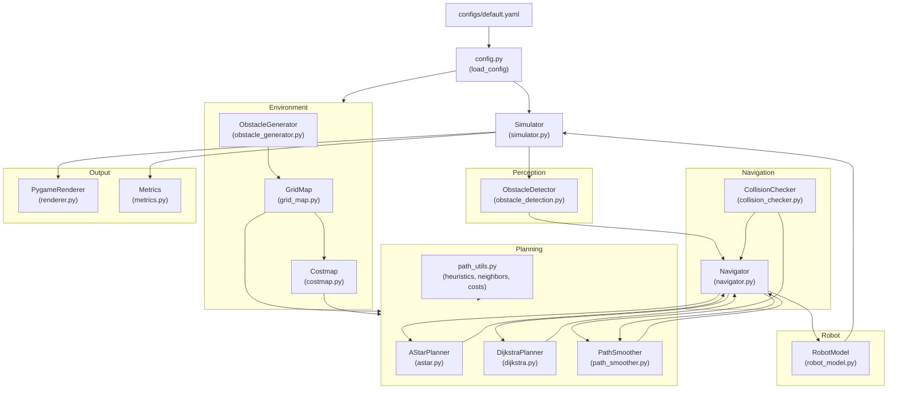

# System Architecture

This document describes the module layout, data-flow, and design decisions of the AI-Based Autonomous Navigation System.

---

## Design Principles

- **Simulation-first**: Every component runs inside a discrete-time Python simulation loop. No hardware or ROS dependency exists in the current codebase.
- **Modular layers**: Each concern (environment, perception, planning, navigation, visualization, evaluation) lives in its own Python sub-package under `src/autonomous_navigation/`.
- **Test-driven**: All logic-bearing modules have corresponding tests in `tests/`. Physical unit conventions are verified by a separate 48-point consistency validator (`scripts/validate_consistency.py`).
- **Configuration-driven**: Hyperparameters (map size, resolution, planner, densities, robot radius, sensor range) live in `configs/default.yaml` and are loaded through typed dataclasses (`config.py`).

---

## High-Level Data Flow

---

## Module Responsibilities

### `config.py`

- Defines typed dataclasses: `EnvironmentConfig`, `RobotConfig`, `PlannerConfig`, `CostmapConfig`, `SimulationConfig`, `VisualizationConfig`.
- `load_config(path)` reads `default.yaml` and returns a populated root config object.
- CLI argument overrides in `main.py` mutate the config object before passing it to `Simulator`.

---

### `environment/grid_map.py` — `GridMap`

- Stores a 2D `numpy` boolean occupancy array (`True` = obstacle).
- Provides `is_valid(x, y)`, `is_obstacle(x, y)`, `is_free(x, y)`, `set_obstacle(x, y)`.
- `grid_to_world(gx, gy)` and `world_to_grid(wx, wy)` convert between cell indices and metric world coordinates using `resolution` (metres per cell).
- **Important**: world coordinates are at the cell-centre (`gx * resolution + resolution/2`).

---

### `environment/costmap.py` — `Costmap`

Wraps a `GridMap` with a layered cost grid computed via Euclidean distance transform:

| Cost Value | Meaning |
| :---: | :--- |
| `254` | Lethal obstacle — the cell itself is occupied |
| `253` | Inscribed infeasible zone — free cell within `robot_radius` of an obstacle |
| `1–199` | Soft clearance penalty — exponential or linear decay within inflation radius |
| `0` | Free and clear |

- Implements an exact, vectorized NumPy Euclidean point-to-obstacle distance transform (`_compute_obstacle_clearance`) without requiring SciPy.
- `is_traversable(x, y)` returns `True` only for cells with cost `< 253`.
- `get_traversal_penalty(x, y, weight)` returns the additional cost added to diagonal/cardinal moves.
- Boundary cells are treated as if adjacent to an obstacle (clearance = half a cell width).

---

### `environment/obstacle_generator.py` — `ObstacleGenerator`

- Procedurally places random obstacles on a `GridMap` using a seeded `numpy` RNG.
- Reserves a guaranteed clear zone around the start and goal positions.
- Configurable `obstacle_density` controls the fraction of interior cells that become obstacles.

---

### `perception/obstacle_detection.py` — `ObstacleDetector`

- Simulates a planar LiDAR-style range sensor by ray-casting from the robot's current world position outward in `num_sensor_rays` equally-spaced angular directions.
- Returns a list of detected obstacle world coordinates within `sensor_range` metres.
- Used by `Simulator` each step to update local obstacle awareness in `Navigator`.

---

### `planning/astar.py` — `AStarPlanner`

- Standard A\* on a 2D grid with binary min-heap (`heapq`).
- Accepts either a `GridMap` or a `Costmap`; dispatches neighbor cost via `path_utils.get_neighbors()`.
- Step costs: cardinal = `1.0`, diagonal = `math.sqrt(2)`.
- Heuristics: `"euclidean"` (default), `"octile"`, `"manhattan"`.
- Raises `UserWarning` at construction if Manhattan heuristic + diagonal movement are combined (inadmissible combination).
- Returns `PlanResult(path, cost, nodes_explored, execution_time_ms, explored_nodes)`.

---

### `planning/dijkstra.py` — `DijkstraPlanner`

- Uniform-cost search; same interface and neighbor model as `AStarPlanner`.
- Equivalent to A\* with $h(n) = 0$.
- Returns the same `PlanResult` dataclass.

---

### `planning/path_utils.py`

- `euclidean_distance`, `manhattan_distance`, `octile_distance` — heuristic functions.
- `get_neighbors(node, grid_map, allow_diagonal, cost_weight)` — returns adjacent traversable cells with correct step costs for both `GridMap` and `Costmap`.
- `is_passable(map_obj, x, y)` — dispatches between `GridMap.is_free()` and `Costmap.is_traversable()`.
- `calculate_path_length(path)` — cumulative Euclidean length.
- `reconstruct_path(came_from, current)` — traces parent map back to start.

---

### `planning/path_smoother.py` — `PathSmoother` and `SmoothingResult`

- `SmoothingResult` is a dataclass with 9 fields:
  - `smoothed_path`, `original_path`, `is_smoothed`, **`is_path_valid`**, `original_length`, `smoothed_length`, `original_waypoint_count`, `smoothed_waypoint_count`, `length_reduction_ratio`.
  - `is_path_valid` is set explicitly at every return site — it is never inferred from `is_smoothed`.
- `smooth_path(path, map_obj)` applies greedy shortcutting:
  1. Empty path → `is_path_valid=False`.
  2. Single-point path → `is_path_valid` from `CollisionChecker.is_state_valid()`.
  3. Multi-point path: validate input, then attempt line-of-sight shortcuts via `CollisionChecker.is_path_valid()`. If the shortcutted path fails final validation, fall back to the original path with `is_path_valid=True`.

---

### `navigation/collision_checker.py` — `CollisionChecker`

- Models the robot as a circle with radius `robot_radius`.
- `is_state_valid(point, map_obj)` — checks whether a single world coordinate is collision-free given the robot's radius.
- `is_path_valid(path, map_obj)` — checks every segment of a path by sampling at `step_size` intervals.
- Works with both `GridMap` and `Costmap`.

---

### `navigation/navigator.py` — `Navigator`

- Stores the active path, current waypoint index, and last plan/smoothing results.
- `plan_to_goal(start, goal, map_obj, smooth_path)`:
  1. Runs the configured planner.
  2. Optionally smooths via `PathSmoother`.
  3. **Validity guard**: if `smooth_res.is_path_valid is False`, clears navigation state and returns `False` without assigning the invalid path.
- `step(robot_pos)` — advances the waypoint index when the robot is within `goal_tolerance` of the current waypoint; returns `True` when the final waypoint is reached.
- `replan(start, goal, map_obj)` — replans directly using the collision checker without the smoother.

---

### `robot/robot_model.py` — `RobotModel`

- State: `(x, y, theta, velocity)` in world coordinates.
- `move_toward(target, dt)` — computes heading toward target waypoint and advances position by `speed * dt`.
- Records full trajectory history.

---

### `simulation/simulator.py` — `Simulator`

- Master loop: calls `ObstacleDetector`, `Navigator.step()`, `RobotModel.move_toward()`, `PygameRenderer.draw()`, and collision detection each simulation step.
- Terminates on: goal reached, collision, max steps exceeded.
- Returns `SimulationResult(success, metrics, status_message)`.

---

### `simulation/renderer.py` — `PygameRenderer`

- Renders the 50×50 grid scaled to a 700×700 px window (14 px/cell).
- Color codes: white = free, black = obstacle, gradient colours = costmap layers, green = path, grey = explored nodes, yellow = sensor rays.
- Gracefully skips rendering when `headless=True`.

---

### `evaluation/metrics.py`

- `evaluate_run(path, start, goal, steps_taken, execution_time_ms)` computes:
  - Total path length (metres), straight-line distance, path efficiency ratio, steps, time, and angular smoothness.

---

## Configuration Reference

All values are in `configs/default.yaml`. Key parameters:

| Parameter | Default | Description |
| :--- | :--- | :--- |
| `environment.width` / `height` | 50 | Grid dimensions in cells |
| `environment.resolution` | 1.0 | Metres per cell |
| `environment.obstacle_density` | 0.20 | Fraction of cells that are obstacles |
| `environment.seed` | 42 | RNG seed for reproducibility |
| `robot.radius` | 0.35 | Collision radius in metres |
| `robot.speed` | 1.0 | Movement speed in m/s |
| `planner.algorithm` | `"astar"` | `"astar"` or `"dijkstra"` |
| `planner.heuristic` | `"euclidean"` | `"euclidean"`, `"octile"`, or `"manhattan"` |
| `planner.allow_diagonal` | `true` | 8-connected vs 4-connected search |
| `planner.smooth_path` | `false` | Enable path smoother |
| `costmap.enabled` | `false` | Use costmap layer |
| `costmap.inflation_radius` | 1.5 | Clearance decay extent in metres |
| `simulation.max_steps` | 1000 | Maximum simulation steps before timeout |
| `simulation.headless` | `false` | Disable pygame display |
