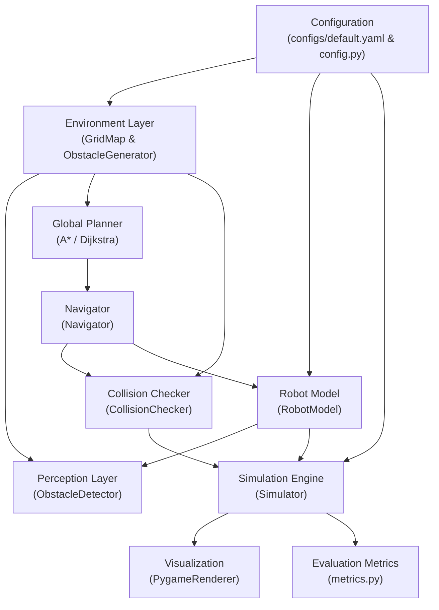

# AI-Based Autonomous Navigation System
## Technical Knowledge Base & Architectural Reference

This document serves as the centralized technical knowledge repository for the **AI-Based Autonomous Navigation System**. It details the mathematical foundations, architectural structure, implementation specifics, safety verifications, and module-wise designs developed across Milestones 1 and 2.

---

## 1. High-Level System Architecture & Pipeline

The system is constructed as a decoupled, modular, simulation-first robotics software stack. It separates state estimation, sensor perception, path search, trajectory tracking, and geometric collision verification.

### End-to-End Execution Data Flow



---

## 2. Module-by-Module Technical Breakdown

### 2.1 Configuration Layer (`autonomous_navigation.config`)
* **File**: `src/autonomous_navigation/config.py`
* **Configuration Source**: `configs/default.yaml`

#### Technical Purpose
Decouples execution parameters (robot radius, speed, map dimension, sensor specifications, algorithm selections) from code logic.

#### Design & Structure
* Built using standard Python `dataclasses`:
  * `EnvironmentConfig`: `width`, `height`, `resolution`, `obstacle_density`, `seed`.
  * `RobotConfig`: `start_pos`, `goal_pos`, `radius` (default $0.35$), `speed` ($1.0$), `sensor_range` ($6.0$), `num_sensor_rays` ($36$).
  * `PlannerConfig`: `algorithm` (`"astar"`, `"dijkstra"`), `heuristic` (`"euclidean"`, `"octile"`, `"manhattan"`), `allow_diagonal` (boolean).
  * `SimulationConfig`: `max_steps`, `dt`, `headless` mode.
  * `VisualizationConfig`: `cell_size` (px), `fps`, `show_sensors`, `show_path`, `show_explored`.
  * `LoggingConfig`: `level` (`"INFO"`, `"DEBUG"`).
  * `AppConfig`: Consolidated container with `load_config(path)` YAML loader.

---

### 2.2 Environment & Grid Map (`autonomous_navigation.environment`)
* **Files**:
  * `src/autonomous_navigation/environment/grid_map.py`
  * `src/autonomous_navigation/environment/obstacle_generator.py`

#### Technical Purpose
Provides discrete 2D occupancy spatial representation and repeatable procedural obstacle topologies.

#### `GridMap` Implementation
* **Underlying Representation**: A 2D NumPy array `uint8` of shape $(H, W)$, where:
  * $0$: Free traversable space.
  * $1$: Occupied obstacle / wall.
* **Coordinate Systems**:
  * **Discrete Grid Coordinates** $(gx, gy)$: Integer indices representing grid cells $[gx, gx+1) \times [gy, gy+1)$.
  * **Continuous World Coordinates** $(wx, wy)$: Real-number coordinates in meters. Cell centers reside at $(gx + 0.5) \times \text{resolution}$.
* **Type-Safe Boundary Checking**:
  `is_valid(x, y)` explicitly rejects non-integers, floats (`1.5`), and booleans (`True/False`) before array indexing, preventing NumPy `IndexError`.

#### `ObstacleGenerator` Implementation
* `add_boundary_walls(grid_map)`: Surrounds outer borders with obstacle cells to enforce finite boundary containment.
* `add_random_obstacles(grid_map, density, seed, safe_positions, safe_radius)`:
  * Deterministic procedural generation controlled by a pseudo-random number generator (`np.random.default_rng(seed)`).
  * Masks spherical clearance envelopes around start and goal coordinates using `safe_radius` to ensure start and destination cells are never blocked at initialization.
* `add_box_obstacle(...)` & `add_circle_obstacle(...)`: Deterministic geometric shape placement for controlled benchmarking.

#### `Costmap` Implementation (`costmap.py`)
* Multi-tiered 2D cost representation adhering to robotics navigation standards:
  * `FREE_SPACE = 0`: Free traversable space outside inflation margin.
  * `LETHAL_OBSTACLE = 254`: Cells directly occupied by obstacles in the underlying `GridMap`.
  * `INSCRIBED_INFLATED = 253`: Free cells located within distance $d < r_{\text{robot}}$ of an obstacle where circular footprint would collide.
  * `INFLATION_COST_RANGE = [1, 199]`: Graded soft traversal penalties within $r_{\text{robot}} \le d < r_{\text{robot}} + r_{\text{inflation}}$ decaying exponentially or linearly.
* **Exact Euclidean Distance Field**: Computed via `scipy.ndimage.distance_transform_edt` (with pure NumPy vectorized fallback) yielding exact clearance $d(x, y)$ in world units (meters).
* **Cost-Aware Planning Interoperability**: Planners adjust traversal cost to $\text{cost}(u, v) = \text{dist}(u, v) \cdot (1.0 + \text{weight} \cdot c(v) / 255)$, steering trajectories naturally into high-clearance corridors.

---

### 2.3 Perception & Range Sensing (`autonomous_navigation.perception`)
* **File**: `src/autonomous_navigation/perception/obstacle_detection.py`

#### Technical Purpose
Simulates planar 2D LiDAR range measurements from the robot's current continuous pose $(x, y, \theta)$.

#### Algorithmic Details
* **Raycasting Scan**: Distributes $N$ angular rays uniformly over $360^\circ$ ($2\pi$ radians):
  $$\theta_i = \text{heading} + i \cdot \frac{2\pi}{N}, \quad i \in [0, N-1]$$
* **Ray Marching**: Steps forward along each ray vector by `step_size = 0.2` grid units:
  $$x(s) = x_0 + s \cos(\theta_i), \quad y(s) = y_0 + s \sin(\theta_i)$$
* **Intersection Detection**: Converts continuous sampling positions to discrete cells $(\lfloor x(s) \rfloor, \lfloor y(s) \rfloor)$. When an obstacle cell is hit or grid boundary is exceeded, records the exact hit coordinate $(x_{hit}, y_{hit})$ and Euclidean distance $d_i = \min(s, \text{max\_range})$.

---

### 2.4 Path Planning & Graph Search (`autonomous_navigation.planning`)
* **Files**:
  * `src/autonomous_navigation/planning/path_utils.py`
  * `src/autonomous_navigation/planning/astar.py`
  * `src/autonomous_navigation/planning/dijkstra.py`

#### Mathematical Formulations

1. **Dijkstra's Uniform-Cost Search**:
   * Evaluates nodes by exact accumulated path cost: $f(n) = g(n)$.
   * Guarantees optimal minimal cost path on graphs with non-negative edge weights.

2. **$A^*$ Heuristic Search**:
   * Evaluates nodes by estimated total cost: $f(n) = g(n) + h(n)$.
   * $g(n)$: Minimal cost discovered from start node to node $n$.
   * $h(n)$: Heuristic estimate of the distance from node $n$ to goal node.

3. **Heuristics & Admissibility Criteria**:
   * **Euclidean Distance**:
     $$h_{\text{euc}}(n) = \sqrt{(x_g - x_n)^2 + (y_g - y_n)^2}$$
     Admissible and consistent for both 4-connected and 8-connected graphs.
   * **Octile Distance** (Standard for 8-connected grids):
     Let $\Delta x = |x_g - x_n|$ and $\Delta y = |y_g - y_n|$:
     $$h_{\text{oct}}(n) = \max(\Delta x, \Delta y) + (\sqrt{2} - 1) \min(\Delta x, \Delta y)$$
     Tightest admissible and consistent heuristic for 8-connectivity. Accelerates search by up to $80\%$ compared to Dijkstra while maintaining exact mathematical optimality.
   * **Manhattan Distance**:
     $$h_{\text{man}}(n) = |x_g - x_n| + |y_g - y_n|$$
     Admissible **strictly** on 4-connected grids. On 8-connected grids, $h_{\text{man}}(n) > h^*(n)$ because diagonal moves cost $\sqrt{2} \approx 1.414$ instead of $2.0$. An explicit `UserWarning` is triggered if Manhattan is selected with diagonal movement.

4. **Connectivity & Diagonal Pinch-Point Prevention**:
   * **Orthogonal Steps**: Step cost $= 1.0$.
   * **Diagonal Steps**: Step cost $= \sqrt{2} \approx 1.41421356$.
   * **Corner-Cutting Avoidance**: Moving from $(x, y)$ to $(x+1, y+1)$ requires that both adjacent orthogonal neighbors $(x+1, y)$ and $(x, y+1)$ are free. This prevents paths from clipping through diagonal corners between touching obstacles.

5. **Deterministic Tie-Breaking**:
   Priority queue entries are stored as `(f_score, h_score, counter, node)`:
   * Primary key: Lowest $f(n)$.
   * Secondary key: Lowest $h(n)$ (prioritizes nodes closer to goal among equal $f$).
   * Tertiary key: Integer sequential insertion counter (guarantees strict FIFO determinism).

---

### 2.5 Collision Checking & Trajectory Tracking (`autonomous_navigation.navigation`)
* **Files**:
  * `src/autonomous_navigation/navigation/collision_checker.py`
  * `src/autonomous_navigation/navigation/navigator.py`

#### Continuous Collision Checking (`CollisionChecker`)
* **Robot Footprint**: Modeled as a continuous bounding circle of radius $r = 0.35$ centered at $(x, y)$.
* **Obstacle Proximity Math**:
  For every obstacle cell $(gx, gy)$ within $[\lfloor x - r \rfloor, \lfloor x + r \rfloor] \times [\lfloor y - r \rfloor, \lfloor y + r \rfloor]$, the closest point on the cell box $[gx, gx+1] \times [gy, gy+1]$ to circle center $(x, y)$ is:
  $$x_{\text{close}} = \max(gx, \min(x, gx + 1.0)), \quad y_{\text{close}} = \max(gy, \min(y, gy + 1.0))$$
  Distance: $d = \sqrt{(x - x_{\text{close}})^2 + (y - y_{\text{close}})^2}$. Collision detected if $d \le r$.
* **Anti-Tunneling Sweep Verification**:
  Between successive positions $P_1$ and $P_2$, sample step size is adaptively bounded:
  $$\Delta s = \min(\text{step\_size}, \max(0.02, r / 2.0))$$
  Guarantees intermediate samples overlap by at least $50\%$ of the robot radius, preventing high-speed tunneling through thin obstacle borders.

#### Trajectory Tracking (`Navigator`)
* **Waypoint Conversion**: Grid paths $[(x_0, y_0), (x_1, y_1), \dots]$ convert to continuous coordinates $[(x_0+0.5, y_0+0.5), \dots]$.
* **Safe Waypoint Advancement**:
  * Waypoint tolerance is set to $0.15$.
  * When approaching waypoint $i$, the navigator only advances to waypoint $i+1$ if the direct path segment from the robot's current position to waypoint $i+1$ is verified collision-free by `CollisionChecker`. This prevents the robot from cutting turns early around obstacle corners.
* **Dynamic Replanning**:
  `replan(grid_map, current_pos)` computes a path from current position to goal and verifies the complete new path against `CollisionChecker` before accepting it.

---

### 2.6 Robot Kinematic Model (`autonomous_navigation.robot`)
* **File**: `src/autonomous_navigation/robot/robot_model.py`

#### Kinematics
* State vector: $\mathbf{x} = [x, y, \theta, v]^T$.
* Velocity update over time step $\Delta t$:
  $$\Delta x = x_{\text{target}} - x, \quad \Delta y = y_{\text{target}} - y, \quad d = \sqrt{\Delta x^2 + \Delta y^2}$$
  $$\theta = \text{atan2}(\Delta y, \Delta x)$$
  $$\Delta d = \min(d, v \cdot \Delta t)$$
  $$x_{\text{cand}} = x + \frac{\Delta x}{d} \Delta d, \quad y_{\text{cand}} = y + \frac{\Delta y}{d} \Delta d$$
* **Decoupled Candidate State Pattern**:
  `compute_next_position(...)` calculates candidate pose without modifying internal state.
  Only once verified collision-free by `Simulator`, `apply_motion(...)` updates $(x, y, \theta)$ and logs to `trajectory`. If collision is detected, motion is rejected and the robot remains in its last safe state.

---

### 2.7 Simulation Engine & Visualization (`autonomous_navigation.simulation`)
* **Files**:
  * `src/autonomous_navigation/simulation/simulator.py`
  * `src/autonomous_navigation/simulation/renderer.py`

#### Simulation Loop Execution Order
Each discrete time step executes in strict chronological order:
1. **Perception**: Raycast scan with `ObstacleDetector`.
2. **Current Pose Integrity Check**: Verifies current pose is valid.
3. **Goal Check**: Checks if Euclidean distance to goal center $\le 0.4$.
4. **Waypoint Progress**: Advances waypoints using corner-safe clearance checks.
5. **Pre-Motion Continuous Check**:
   * Computes candidate pose $(x_{\text{cand}}, y_{\text{cand}}, \theta_{\text{cand}})$.
   * Checks `is_path_segment_valid(curr_pos, cand_pos, grid_map)`.
   * If free: calls `apply_motion`.
   * If obstructed: flags collision, rejects motion, terminates simulation.
6. **Rendering**: Draws background, explored nodes, obstacles, path, robot footprint, heading indicator, and LiDAR rays. Supports headless execution for CI/CD.

---

### 2.8 Evaluation Metrics (`autonomous_navigation.evaluation`)
* **File**: `src/autonomous_navigation/evaluation/metrics.py`

#### Formulations
* **Cumulative Path Length**: $L = \sum_{i=0}^{K-2} \|P_{i+1} - P_i\|_2$.
* **Straight-Line Distance**: $D = \|\text{Goal} - \text{Start}\|_2$.
* **Path Efficiency**: $\eta = \frac{D}{L} \in (0, 1]$.
* **Angular Smoothness Score**:
  $$S = \sum_{i=0}^{K-3} |\theta_{i+1} - \theta_i|_{\text{norm}}, \quad |\theta|_{\text{norm}} \in [0, \pi]$$
  Lower scores reflect smoother paths with fewer abrupt directional turns.

---

## 3. Automated Verification & Testing Matrix

The project maintains **44 automated unit tests** across 6 test modules:

| Test Module | Coverage Scope | Verified Properties |
| :--- | :--- | :--- |
| `tests/test_astar.py` | A* Planning | Straight, diagonal, obstacle detour, blocked path, start=goal (free & blocked), invalid coordinates (floats, negatives, malformed), unreachable goal, corner-cutting prevention, Octile distance optimality, Manhattan diagonal warning. |
| `tests/test_dijkstra.py` | Dijkstra & Equivalence | Straight, detour, unreachable, start=goal, invalid coordinates, 8-connected cost equivalence with A*, 4-connected cost equivalence with A*. |
| `tests/test_collision_checker.py` | Geometric Safety | Free space, boundary violation, obstacle proximity, path segment checking, anti-tunneling verification, radius sensitivity, 4-border containment. |
| `tests/test_navigator.py` | Tracking & Replanning | Waypoint tracking, goal reach, replan on obstruction, replan failure on sealed goal, motion collision rejection leaving robot in valid state. |
| `tests/test_grid_map.py` | Environment & Grid | Initialization, dimensions validation, boundary checks, obstacle set/clear, NumPy export/import, boundary walls, seed reproducibility, non-integer type rejection. |
| `tests/test_metrics.py` | Evaluation | Path length, straight-line smoothness ($0.0$), $90^\circ$ turn smoothness ($\pi/2$), full run evaluation. |

---

## 4. Benchmark Results Summary (100 Scenarios)

Evaluated across **100 deterministic scenarios** (seeds $1000$ to $1099$, $50 \times 50$ grid, obstacle density $0.15$):

| Planner | Plan Success | Goal Reached | Collisions | Avg Explored Nodes | Avg Plan Time | Avg Sim Time | Avg Path Cost |
| :--- | :---: | :---: | :---: | :---: | :---: | :---: | :---: |
| **A\* (Euclidean)** | 100 / 100 | 100 / 100 | **0** | 650.4 | 21.54 ms | 11.15 ms | **62.32** |
| **A\* (Octile)** | 100 / 100 | 100 / 100 | **0** | **390.5** | **13.26 ms** | **10.75 ms** | **62.32** |
| **Dijkstra** | 100 / 100 | 100 / 100 | **0** | 1945.3 | 59.27 ms | 11.48 ms | **62.32** |

* Machine-readable dataset preserved at: [`outputs/metrics/benchmark_results.json`](file:///c:/Users/ADMIN/OneDrive/Desktop/AI%20projects/AI-Based%20Autonomous%20Navigation%20System/outputs/metrics/benchmark_results.json).

---

## 5. Execution Reference & Commands

* **Run Full Test Suite**:
  ```bash
  pytest -v
  ```
* **Run Headless Simulation (A*)**:
  ```bash
  python main.py --headless --planner astar --density 0.15 --seed 42
  ```
* **Run Headless Simulation (Dijkstra)**:
  ```bash
  python main.py --headless --planner dijkstra --density 0.15 --seed 42
  ```
* **Run 100-Scenario Benchmarking**:
  ```bash
  python scripts/run_benchmarks.py --scenarios 100 --density 0.15
  ```
* **Run Interactive GUI Simulation**:
  ```bash
  python main.py
  ```
